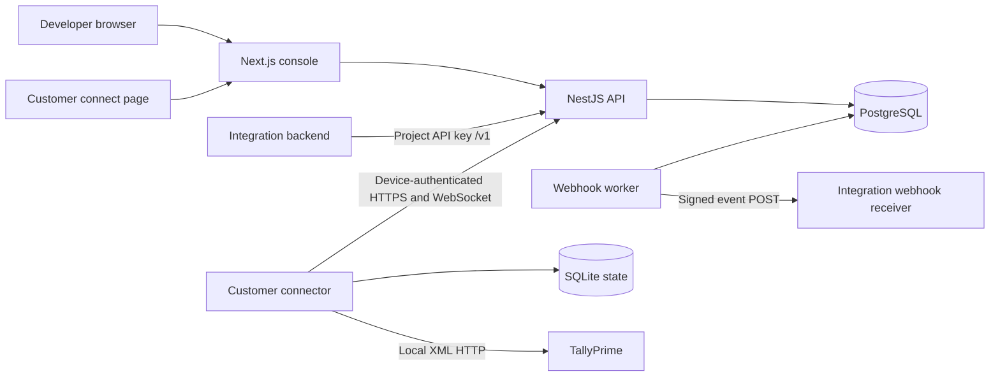

# Architecture and code map

The cloud is a NestJS API and PostgreSQL database. A Next.js console provides management screens and public docs. The connector uses a shared TypeScript engine to translate definitions and JSON writes into Tally XML, normalize responses and apply customer privacy policy.

## API surfaces

| Surface | Authentication | Responsibilities |
|---|---|---|
| `/v1` | Project API key, exact explicit scope | Integration reads/writes, connection management, schemas, discovery, webhooks, usage |
| `/console/v1` | `hx_session` cookie | Tenant/project management behind console UI |
| `/connector/v1` | Installation device secret; first enrollment uses connect token | Enrollment, bundle fetching, uploads, reconciliation, jobs |
| `/connect/:token/state`, `/connect/:token/approve` | Token in URL | Customer approval flow |
| `/healthz`, `/readyz` | None | Process liveness and database readiness |

The console proxies `/console-api/*` to `/console/v1/*`. It proxies the two customer connect actions separately. It does not proxy public `/v1` calls. Browser sessions and public API keys are different credentials.

## Main flows

**Connect:** a project creates a token-hashed link. The connector enumerates local companies and enrolls against the link. First enrollment creates a fresh device identity; further links can use its existing device secret. The customer selects a company and privacy rules. An atomic link claim creates or reactivates the project/installation/company connection, publishes a signed bundle and nudges sync.

**Sync:** the connector verifies the active bundle and applies locally retained privacy rules. It pulls initial data in bounded pages or windows, then uses AlterID watermarks for deltas. A SQLite outbox holds batches until the cloud acknowledges them; only then does local progress advance. The cloud applies current allowed fields and stores normalized records. Initial mode suppresses record-created/updated events; delta and repair changes can emit them.

**Deletion and repair:** periodic key snapshots identify missing records. Empty snapshots are rejected/ignored rather than trusted. When at least 10 records and more than 20% of the live dataset appear missing, the cloud records a deletion hold. Lower AlterIDs or unseen IDs trigger repair paths. The thresholds and restored-backup behavior require real Tally evaluation.

**Live read:** the public API signs an expiring probe and routes it over the installation's open WebSocket. The connector verifies the signature, checks probe expiry, runs bounded read-only XML through its Tally request queue and applies privacy before replying. Availability errors become 502/503/504 API responses. Live reads do not update the synced cache.

**Write:** the API validates the input, binds a project-wide idempotency key to connection/dataset/action/record/body, compiles guarded XML and signs a job. The connector claims the earliest unfinished job per connection with masters prioritized. It durably records local job state (`seen`, `posting`, `done`); voucher creates look for the remote ID before posting. After preflight and import it reports a terminal result. The first terminal cloud result wins, and the webhook worker delivers the outcome asynchronously. These protections still require real Tally duplicate/lookup verification.

**Schema change:** adding a custom field publishes a new immutable bundle with updated OpenAPI and pins the connection to it. Rollback re-pins an existing version. The connector notices definition/hash changes and re-pulls as needed. Existing signed bundles are stored in PostgreSQL, so changing generator code does not rewrite previously published schemas.

## WebSocket protocol

The connector opens `/connector/v1/channel` using `Authorization: Bearer <device-secret>` over `wss` in deployed environments. Only one active channel per installation is retained; a new channel replaces the old one. The API sends WebSocket pings every 30 seconds and terminates unresponsive peers.

| Direction | JSON message | Purpose |
|---|---|---|
| Connector → API | `{ "t": "status", "tallyOpen": true }` | Update Tally availability |
| API → connector | `{ "t": "call", "id": "request-id", "envelope": {} }` | Run signed read/validation/discovery probe |
| Connector → API | `{ "t": "reply", "id": "request-id", "ok": true, "data": {} }` | Resolve the matching live call |
| Connector → API | `{ "t": "reply", "id": "request-id", "ok": false, "error": { "code": "...", "message": "..." } }` | Reject the matching live call |
| API → connector | `{ "t": "nudge", "what": "sync" }` or `"jobs"` | Prompt work before the next poll |

Envelope shape is `{kind,payload,kid,sig}`. Ed25519 signs `hexspare-tally/v1\n<kind>\n<canonical JSON payload>`, using sorted object keys and a base64url signature. The kind binds bundles, jobs and probes to their intended use. See `packages/engine/src/bundle.ts`; reimplementations must match its canonicalization exactly. OpenAPI documents the HTTP protocol; it does not model this persistent channel.

## Source map

| Location | Read or change it when |
|---|---|
| `apps/cloud/src/public.controller.ts` | Adding public endpoints, query/body validation or required API scopes |
| `apps/cloud/src/platform.ts` | Changing schema publication, reads, sync/reconciliation, usage or job ordering/idempotency |
| `apps/cloud/src/connect.controller.ts` | Changing customer link state and approval |
| `apps/cloud/src/connector.controller.ts` | Changing device HTTP protocol |
| `apps/cloud/src/hub.ts` | Changing live-call routing, channel presence or timeouts |
| `apps/cloud/src/console.controller.ts`, `console-auth.ts` | Changing console management, sessions, passwords or origin checks |
| `apps/cloud/src/webhooks.ts` | Changing delivery signatures, retry policy or outbound target checks |
| `apps/cloud/src/main.ts` | Changing server/worker/migration/seed/keygen roles |
| `apps/connector/src/runtime.ts` | Changing sync, policies, preflight, job execution or channel reconnection |
| `apps/connector/src/store.ts` | Changing SQLite outbox, watermarks, revocation or local job durability |
| `apps/connector/src/tally-client.ts` | Changing local HTTP transport and priority/serialization |
| `packages/engine/src` | Changing templates, guards, parsing, normalization, privacy, discovery, signing or writes |
| `packages/engine/src/openapi.ts` | Changing per-connection dataset OpenAPI generation |
| `packages/engine/src/standard-pack.generated.json` | Generated dataset/template definitions; rebuild via `pnpm generate` |
| `apps/console/src/app`, `src/components` | Changing console pages and UI workflows |
| `apps/console/content/docs` | Editing browser-visible documentation |
| `scripts/generate-openapi.ts` | Updating complete public/internal HTTP reference contracts |
| `db/migrations` | Evolving the PostgreSQL schema through numbered migrations |
| `packages/fake-tally` | Extending the simulator and failure modes for tests |

The migration schema groups tenant/project/access records, installations/links/connections, schema/dataset/field definitions, normalized records/sync state/issues, write jobs, webhook endpoints/deliveries, usage, and console users/sessions. `record.raw` remains unused by this implementation.

## Checks for maintainers

- Engine tests cover guards, templates, parsing, privacy, write compilation and signatures. The Step 0 gate compares generated XML with the legacy builders when available.
- Cloud integration tests use a real disposable PostgreSQL database and Fake Tally/connector runtimes. Start development PostgreSQL before running the full suite.
- Console typechecking compiles MDX, and the browser smoke test exercises running services.
- `pnpm docs:check` checks generated contract freshness and contract structure/route coverage. After editing the console contract, regenerate `api-types.ts`.

See [ADR-2](adr/0002-build-decisions.md) for the reasons behind implementation choices and [the application guide](app-guide.md#current-limitations) for material gaps.
